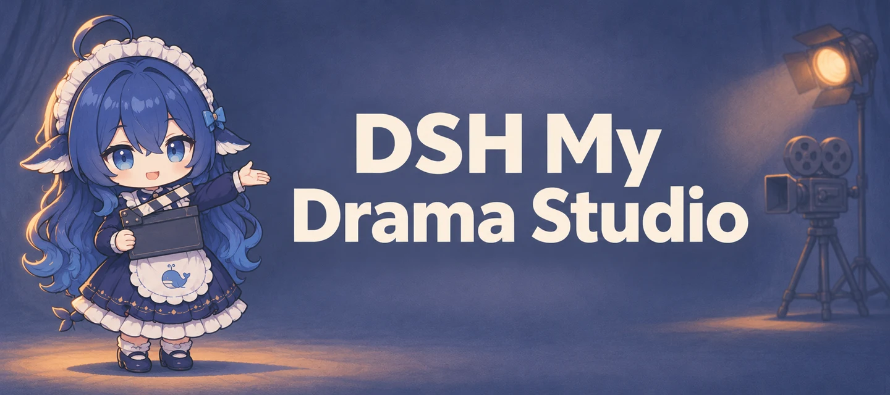
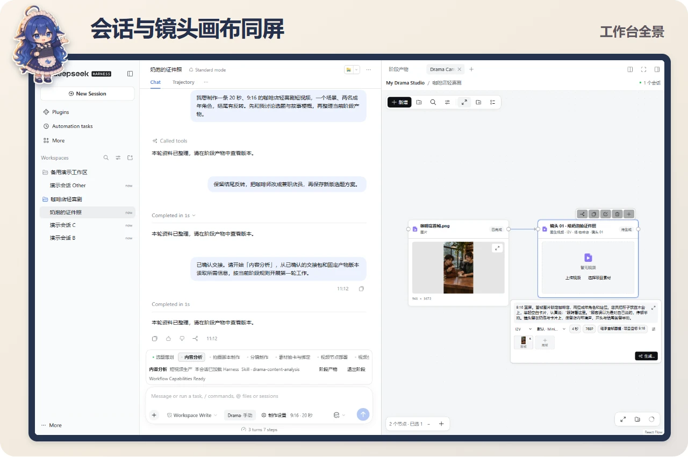
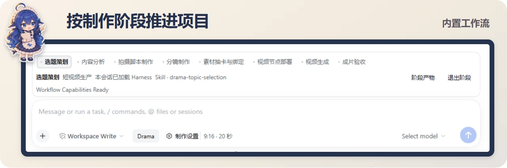
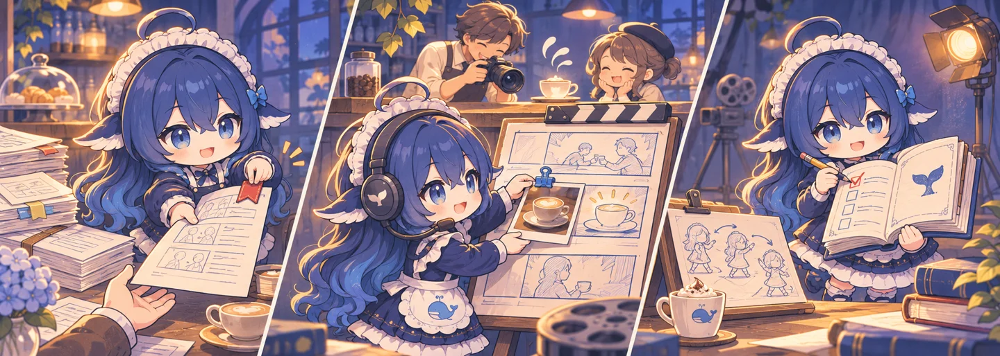
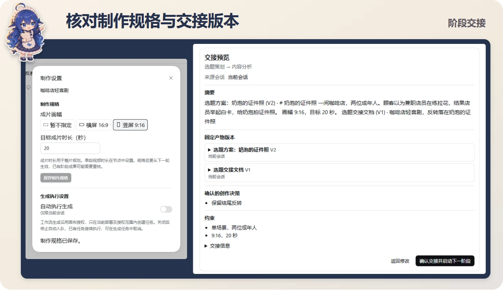
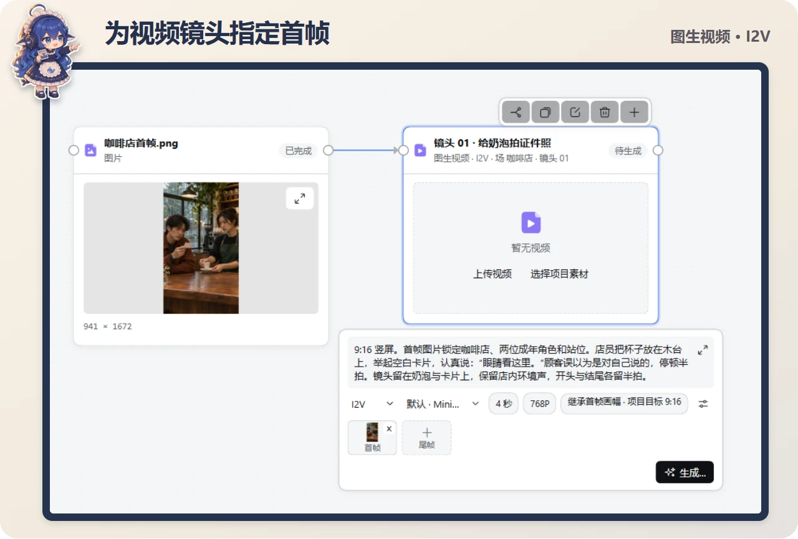
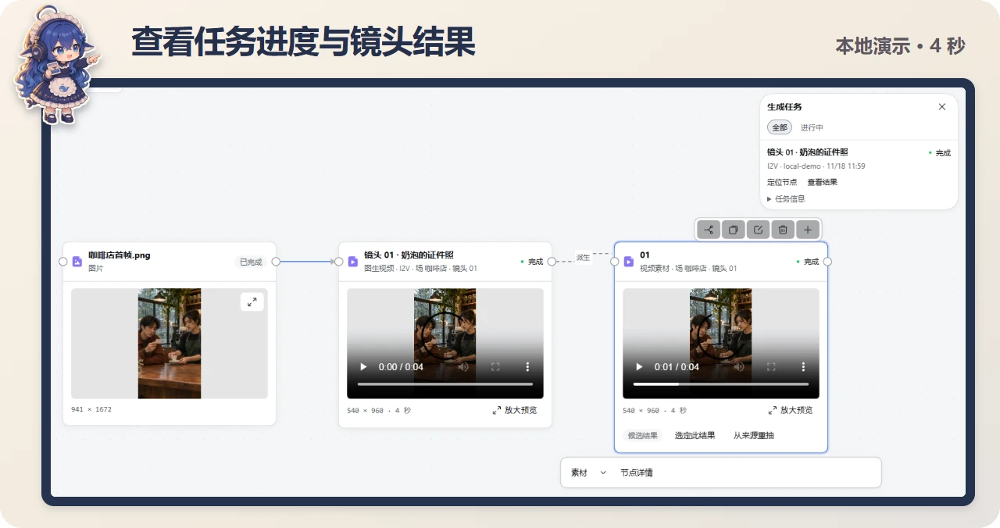
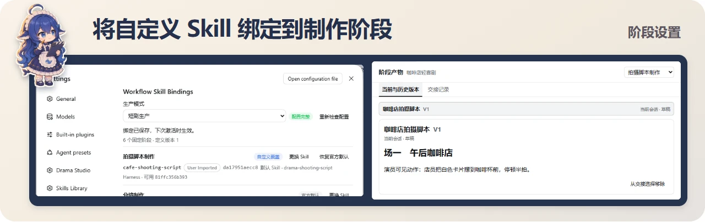
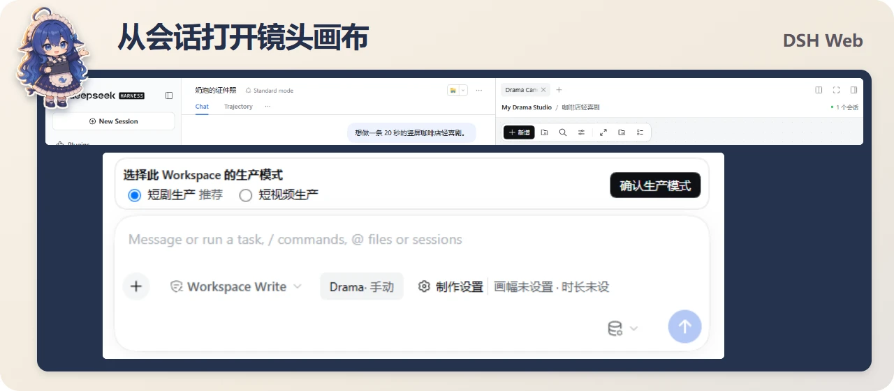

<h1 align="center"><br>从创意到成片，一站搞定</h1>

<p align="center"><strong>内置工作流开箱即用，支持装填自己的 Skills。</strong></p>

<p align="center">
  <a href="docs/user/installation.md"></a>
  <a href="docs/user/installation.md"><picture><source media="(prefers-reduced-motion: no-preference)" srcset="docs/assets/guided-tour/badge-host.svg"></picture></a>
  <a href="LICENSE"></a>
</p>

**DSH My Drama Studio** 是 DeepSeek Harness 里的短剧与短视频工作台。你可以和 AI 一起把创意写成脚本、拆成分镜，在画布上用参考素材生成镜头，再对照分镜逐条验收。你决定用哪一稿、留哪一条，工作台保存各阶段的产物和交接记录。

<p align="center"><a href="#studio-tour"><strong>看工作台</strong></a> · <a href="#install"><strong>安装</strong></a> · <a href="#skills"><strong>装填 Skills</strong></a> · <a href="docs/README.md#用户指南">用户指南</a></p>

<a name="studio-tour"></a>

[](docs/assets/screenshots/workspace.webp)

##  内置工作流，选好就开工

项目的制作顺序和每个阶段使用的 Skill 都已配好。根据手上的材料选一个起点，就可以开始创作。

| 制作模式 | 从哪里开始 |
| --- | --- |
| **短视频生产** | 从选题策划和内容分析开始，确定主题、受众和叙事方向，再进入拍摄脚本制作。 |
| **短剧生产** | 从已有故事或剧本直接进入拍摄脚本制作，整理每场戏的人物、动作和对白。 |

两条流程都能继续做分镜、绑定素材、生成视频和验收成片。项目画幅和目标时长可统一设定，各镜头按分镜安排时长。

<picture><source media="(prefers-reduced-motion: no-preference)" srcset="docs/assets/guided-tour/workflow.svg"></picture>

[](docs/assets/screenshots/workflow.webp)

##  从剧本到分镜，按版本交接

拍摄脚本按场次整理地点、人物、动作和对白。确定脚本后，分镜制作再把每场戏拆成镜头，列出景别、运镜、时长、声音和所需素材。到画布准备镜头时，你手里已经有一份逐镜制作清单。



修改过的方案、脚本和分镜都能在 **阶段产物** 里查看历史版本。选定要交接的那一稿，在 **交接预览** 核对版本与创作要求，确认后下一阶段就能沿用。 [阶段产物与交接指南](docs/user/first-project.md#4-确认交接并查看下一阶段)

[](docs/assets/screenshots/handoff.webp)

##  从参考素材到视频镜头

把图片、视频和音频拖进 **Drama Canvas**，为每个镜头挑选需要的素材。图生视频可以指定首帧，参考生视频可以关联模型支持的媒体。在视频节点内写齐场景、表演、动作、对白、声音、素材用途和首尾停顿，节点只连接实际使用的图片、视频或音频。

[](docs/assets/screenshots/canvas.webp)

提交前可核对模型、渠道、画幅和时长。提交后在 **任务** 里查看进度，完成的片段会回到画布，并保存在项目文件夹。创作对话和视频生成分别使用所配置服务的额度。 [画布与镜头生成](docs/user/canvas.md) · [配置模型与渠道](docs/user/models-and-providers.md)

##  逐镜回放，按时间点验收

在画布上回看同一镜头的不同结果，用 **选定此结果** 标出要用的版本。进入 **成片验收** 后，可以对照分镜检查画面、声音和镜头衔接，把需要返工的位置记到逐镜报告里。复核后，由你确认最终验收包。 [成片验收指南](docs/user/first-project.md#从镜头生成走到成片验收)

[](docs/assets/screenshots/canvas-result.webp)

*图中为本地演示服务返回的 4 秒片段，展示工作台的任务查询、下载与回放。*

<a name="skills"></a>

##  给制作流程装填自己的 Skills

**Skill 是交给 AI 的阶段工作方法。** 可以让拍摄脚本遵循你的对白格式，让分镜使用你的镜号和表格，也可以让成片验收沿用你的审片清单。

在 **Settings → Skills Library** 导入自己的 Skill 文件夹，正文、模板和参考资料可以一并带入。也可以复制内置 Skill，在副本上修改。到 **Workflow Skill Bindings** 将它绑定到指定制作模式与阶段，保存后重新激活该阶段。用同一份输入比较两版产物，就能判断新规则有没有达到预期。 [装填、调整和恢复 Skills](docs/user/skills.md)

[](docs/assets/screenshots/skill-output.webp)

<a name="install"></a>

##  在 Windows 安装并启动工作台

已验证环境为 **Windows x64** 和 **DeepSeek Harness Desktop 0.2.1-rc.3**。插件候选包 **`dsh-my-drama-studio-0.1.0.tgz`** 需向维护者获取。截至 2026-11-18，公开 Releases 尚无插件附件。 [安装包与宿主说明](docs/user/installation.md)

在插件包所在文件夹打开 PowerShell。如果 `dsh --version` 能显示版本，运行下面一行安装插件。

```powershell
dsh plugin --profile web add "$PWD\dsh-my-drama-studio-0.1.0.tgz"
```

安装成功后启动 Web 工作台。

```powershell
dsh web --host 127.0.0.1 --port 3080
```

在浏览器的 **Workspaces** 里选项目文件夹，点 **New Session**，再点输入栏的 **Drama** 打开画布。终端找不到 `dsh` 时，可直接使用 Desktop 随附的启动器。 [启动器路径与完整安装步骤](docs/user/installation.md#用-powershell-安装并打开) · [使用 HTTPS 包链接](docs/user/installation.md#使用-https-包链接)

[](docs/assets/screenshots/install-launch.webp)

<a name="first-project"></a>

[创建第一个项目](docs/user/first-project.md) · [全部用户指南](docs/README.md#用户指南) · [常见问题](docs/user/faq.md) · [开发与贡献](docs/developer/README.md) · [历史记录](docs/README.md#历史记录)
