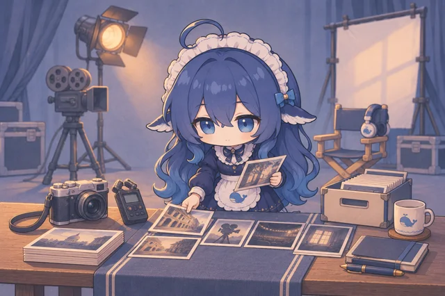
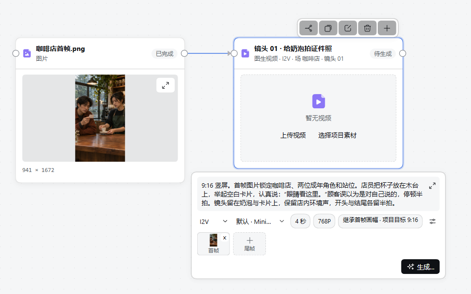
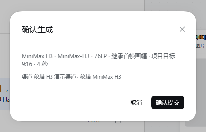

# 画布、素材与镜头生成

[文档总览](../README.md) · [完成第一个项目](first-project.md) · [模型与视频渠道](models-and-providers.md)

## 新建或导入

在项目会话的输入栏点击 **Drama**，右侧打开 **Drama Canvas**。点击 **新增**、在空白处右键或按 **Shift+A**，选择 **视频生成** 等节点类型。节点出现后，在卡片里继续编辑。

把本地图片、视频或音频拖进画布，即可把素材导入项目并添加节点。也可在画布焦点下粘贴剪贴板图片，或用工具栏的 **项目资产** 找到之前导入的文件。导入后打开媒体预览，核对图像、画幅或声音。

## 写提示词并检查实际输入

1. 在视频节点自己的提示词字段写完整内容，包括场景、对白、表演、动作、声音、素材分别用来做什么，以及开头和结尾需要留出的停顿。
2. 选择模型和生成方式，再从媒体节点的输出端口拖到视频节点输入端口，或在视频节点里用 **参考素材**／**添加首帧** 等槽位选择、上传。保存后同时核对画布连线和节点的素材列表。只能连接实际需要的图片、视频和音频，视频节点禁止连接文本节点。
3. 用 `@` 提及素材时，选择可用媒体并确认保存后的实际连线。手打素材名或普通 `@` 文字不会建立连线。引用显示失效时，保留提示词正文，重新连接并选取对应素材，或把无须绑定的旧引用转回普通文字。

| 生成方式 | 核对输入 |
| --- | --- |
| **T2V** 文生视频 | 完整提示词，零条媒体连线。 |
| **I2V** 图生视频 | 一张首帧图。只有模型声明支持尾帧时才可再接尾帧图，核对两张图的顺序。 |
| **R2V** 参考生视频 | 按模型支持的媒体种类、数量及顺序接入。某些模型只接受图片，某些模型还接受视频或音频。 |
| **V2V** 视频生视频 | 一个源视频，选择支持 V2V 的模型和渠道。只把视频作为混合参考时，模式仍可为 R2V。 |

首帧图的右侧输出端口已连到视频节点，节点的 **首帧** 槽位显示同一张图。

## 提交镜头并查看结果

在视频节点核对提示词、生成方式和素材职责，再点击 **生成…**。在确认单核对模型、渠道、时长、分辨率和画幅，点击 **确认提交** 后才会入队。成片的目标时长由 **制作设置** 管理，单段时长由节点和模型能力决定。如果设置刚更新，关闭旧确认单后重新打开核对。

确认单示例使用 I2V，画幅跟随首帧。项目目标画幅也会显示，便于检查两者是否一致。

在画布工具栏点击 **任务** 打开 **生成任务**。**全部** 可回看历史记录，**进行中** 用于查排队和生成进度。成功的任务可点 **查看结果** 定位结果节点，打开视频预览。在 **任务信息** 展开 **本地结果** 查看项目内保存路径，默认目录是 `assets/videos`。排队任务可以用 **取消排队**。

遇到 **提交状态未知** 时，先用时间、模型、本地任务 ID 或已知的供应商任务 ID 查渠道是否接单，确认未接单后才再次提交。若已有供应商任务 ID 且为 **查询暂停**，点 **继续查询**，继续追踪原任务。失败时先查看 **错误与任务信息**。详见[任务排查](faq.md#查询暂停或任务失败)。

## 移动、整理和删除

单击选择，拖动节点调整位置，按住 **空格**拖动可平移画布，工具栏 **适配视图** 可找回画布范围。画布取得焦点后可用 **Ctrl+C / Ctrl+V** 复制粘贴、**Ctrl+D** 复制为新节点、**Ctrl+A** 全选、**Delete / Backspace** 删除、**Ctrl+Z / Ctrl+Shift+Z** 撤销或重做。编辑提示词时，快捷键作用于编辑区。复制一组节点后，检查副本的实际连线。

当前工作区任一已连接的会话显示 **AI 工作中** 时，可以查看、上传素材、新增节点及可直接追加的连线。修改或删除已有节点和连线、撤销或重做等操作需要等相关会话结束。生成任务及其输入也可能有独立的保护。删除节点会从画布移除节点和关联连线，项目素材文件与历史任务保留。

## 自动执行生成

在输入栏 **制作设置 → 生成执行设置** 查看 **自动执行生成**。它只作用于当前会话。开启后仍需要连接画布，并满足当前部署、模型和工作流授权范围。关闭后停止自动入队，已入队任务继续执行，可取消尚在排队的任务。断开当前会话画布或重启 Host 会清除此许可。手工生成仍使用节点的确认单。
