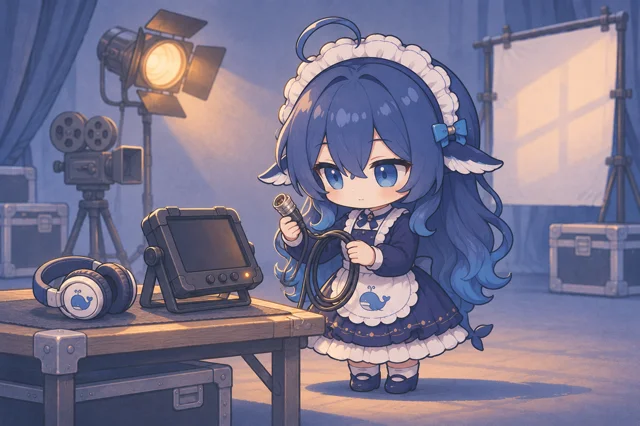

# 常见问题

[文档总览](../README.md) · [安装与启动](installation.md) · [画布与镜头生成](canvas.md)

## 安装后看不到 Drama

先确认打开的是 DSH **Web**，左侧已选 Workspace，且当前页面是项目里的会话。回启动终端检查宿主版本、安装是否成功和启动是否使用同一个 DSH Home 及 `web` Profile。如果 **Settings** 也没有 **Drama Studio**，记录启动输出和包来源以便定位。见[安装与启动](installation.md#用-powershell-安装并打开)。

## 找不到可用的视频模型

在 **Settings → Drama Studio → 视频渠道** 核对渠道和密钥，再在 **模型预设** 确认有一个保存成功的预设绑定此渠道。返回节点，检查该模型支持所选生成方式和参考媒体。**测试连接** 的结果只覆盖面板上显示的检查项。见[配置示例](models-and-providers.md#配置示例秘塔-minimax-h3)。

## 设置已保存但当前窗口没有更新

同一 Profile 的已连接画布会收到配置更新。已打开的生成确认单可能过期，关闭后重开，检查这次实际绑定的预设和渠道。仍不同步时，先确认两边属于同一 DSH Home 和 Profile，再记录保存提示、画布连接状态以及重开前后的显示内容。已入队任务按入队时的配置继续处理。

## AI 工作时改不了节点

查看 Canvas 顶部是否显示 **AI 工作中**。锁定作用于同一工作区的已连接会话，最后一个相关 Agent 结束后才恢复修改和删除。期间可以查看、上传素材和追加新节点。若仍有生成任务在用该节点或素材，也要等任务释放。见[画布操作](canvas.md#移动整理和删除)。

## 阶段产物和聊天有什么区别

聊天保存讨论过程。请 AI 把确定内容保存成阶段产物，再在 **阶段产物** 查看独立条目和历史版本。确认交接会固定此时选中的版本，下一阶段据此继续。见[第一个项目](first-project.md#3-保存查看和修改阶段产物)。

## 确认交接后没有进入下一阶段

回到发起交接的会话，打开 **阶段产物 → 交接记录**。若预览因内容或工作区状态变更失效，按提示重新选版本、生成预览再确认。已有正式交接包而下一阶段尚未运行时，若工作流栏显示 **启动交接后的任务**，用它恢复启动。工作区内其他会话可能已先确认交接，此时先查看该阶段的正式记录。如果入口和状态仍不一致，保留错误提示、当前阶段和交接记录供维护者核对。

## 提交状态未知

渠道可能已收到请求。先展开 **错误与任务信息**，记录本地任务 ID、提交时间和模型。有供应商任务 ID 时直接用它去供应商查。尚无 ID 时用时间与模型核对供应商后台或联系供应商，确认未接单后才重新提交，以免重复计费。

## 查询暂停或任务失败

- **查询暂停。** 有供应商任务 ID 时，在 **生成任务** 点 **继续查询**，沿用原任务。停留在暂停时用同一 ID 核对渠道记录。
- **失败。** 展开 **错误与任务信息**，按提示检查渠道、输入以及结果下载情况。需要再次生成时，先确认原任务的最终状态。如果任务已完成但画布找不到节点，先在历史记录用 **查看结果**，再核对 **本地结果** 路径。

## 更新、卸载后项目在哪里

原项目仍在选用的 Workspace 文件夹中，数据主要在 `.drama-studio`，项目素材和默认生成结果在 `assets`。备份时保留两者，重新安装后选择同一个项目文件夹。更新和卸载过程见[安装指南](installation.md#更新和卸载)。

## 怎样反馈问题

提供 Windows 版本和架构、`dsh --version` 输出、插件包版本或源码提交、Profile 名称、复现步骤和准确报错。生成问题另附渠道协议、模型 ID、生成方式、本地及供应商任务 ID（若允许分享）和时间。交接问题另附模式、阶段与是否已出现正式交接包。

分享前移除 API 密钥、访问令牌、签名 URL、私有地址、个人目录和客户项目内容。截图可用专用演示项目复现。见[开发者反馈入口](../developer/README.md#贡献与问题反馈)。
