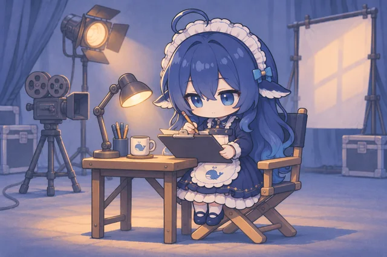
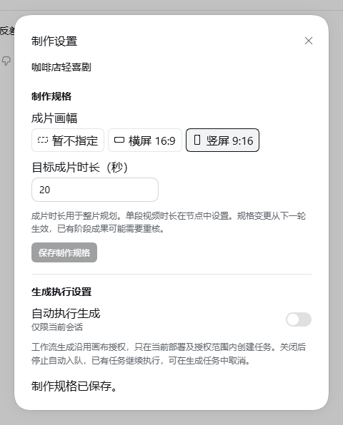
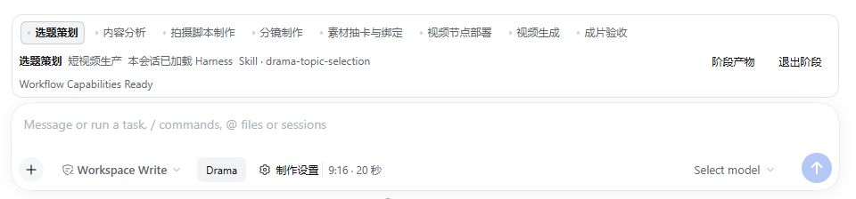
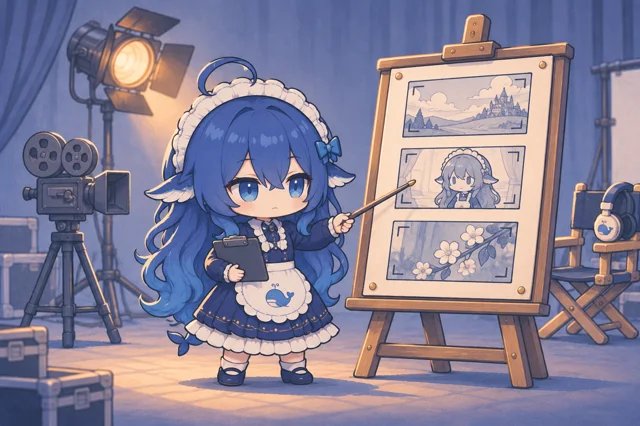
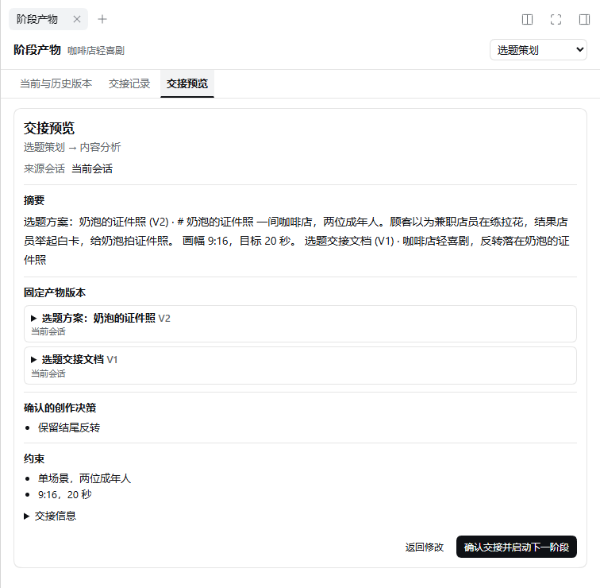
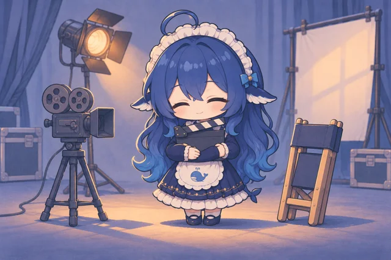

# 完成第一个项目

[文档总览](../README.md) · [安装与启动](installation.md)

用一个场景、两名成年角色做一条 **20 秒、9:16 的咖啡店轻喜剧**。本教程的完成标志是选题产物可查看、交接已确认，且当前会话进入 **内容分析**。发送消息会调用配置好的 DSH 对话模型，可能消耗服务额度。

## 1. 打开项目并设置制作规格

在 DSH Web 左侧 **Workspaces** 区域添加或选择一个专用项目文件夹，例如「咖啡店轻喜剧」，进入该 **Workspace**（工作区），点 **New Session** 新建会话，或打开已有 **Session**（会话）。

在输入栏点击 **制作设置**，在 **制作规格** 里选 **竖屏 9:16**，将 **目标成片时长（秒）** 填为 `20`，点击 **保存制作规格**。看到保存提示后关闭窗口。规格供此工作区内的会话共享，从下一轮阶段任务读取。每个镜头的时长可在节点里单独设定。

## 2. 选择生产模式并讨论选题

查看聊天输入框上方的制作工作流。新工作区第一次打开时，选择 **短视频生产**，点击 **确认生产模式**，再点击 **选题策划**。看到当前阶段是 **选题策划** 后，在输入栏选好[对话模型](models-and-providers.md)，再发送下面这段需求。

> 我想制作一条 20 秒、9:16 的咖啡店轻喜剧短视频，一个场景、两名成年角色，结尾有反转。先和我讨论选题与故事梗概，再整理当前阶段产物。

与 AI 确定笑点、人物和结尾反转，例如「以为咖啡师在练拉花，结果对方在练给奶泡拍证件照」。已有剧本的创作可以用 **短剧生产**，它从 **拍摄脚本制作** 开始。已有工作区可能沿用早期七阶段流程，跟随其界面中显示的阶段即可。激活阶段作用于当前会话。

## 3. 保存、查看和修改阶段产物

请 AI 把确定的内容保存为选题方案，并整理选题交接文档。聊天消息里看到正文后，也要到 工作流栏的 **阶段产物** 检查标题、内容和版本。聊天是讨论过程。保存的阶段产物有单独的版本，后续可以选择交给下一阶段。

需要改动时，回当前聊天告诉 AI 改哪一项并保存新版，例如「保留结尾反转，把咖啡师改成兼职店员，再保存新版选题方案」。在 **阶段产物** 打开历史版本，用 **选此版本交接** 指定要交接的版本。看完其他内容可以回到工作流栏继续。

## 4. 确认交接并查看下一阶段

1. 当前轮完成后，在工作流栏点击 **生成交接预览**。若已有预览，点击 **查看交接预览**。检查方向为 **选题策划 → 内容分析**，再核对选中的产物和版本。
2. 需要调整时点 **返回修改**，保存或重选后点击 **重新生成交接预览**。只有选定产物和约束符合要求时，才点击 **确认交接并启动下一阶段**。
3. 在工作流中看到当前会话进入 **内容分析**，再到 **阶段产物 → 交接记录** 查看正式交接包。确认将选中的版本固定下来，并尝试启动下一个阶段。如果启动中断，查看[交接排查](faq.md#确认交接后没有进入下一阶段)。

## 从镜头生成走到成片验收

第一次交接后，可以继续用同一个项目做完后续阶段。**短视频生产** 会从内容分析接到拍摄脚本和分镜，再进入素材抽卡与绑定、视频节点部署和视频生成。镜头任务使用所配置视频服务的额度。 [配置视频渠道](models-and-providers.md) · [在画布生成和回看镜头](canvas.md)

当 **视频生成** 阶段已有可播放的结果，先确认要交接的镜头版本，再进入 **成片验收**。让 AI 按镜号整理验收报告，记下有问题的时间点、现象和返工条件。比如原分镜要求店员说完台词后停半拍，就回放那一镜，听最后一个字是否说完，看白卡有没有提前离开画面。

在 **阶段产物** 核对报告和所引用的镜头，再回到工作流栏点 **生成成片验收包** 查看预览。需要返工时先记下镜号和问题。接受这版结果时，点 **确认最终验收**，把所选视频版本及验收记录固定下来。
