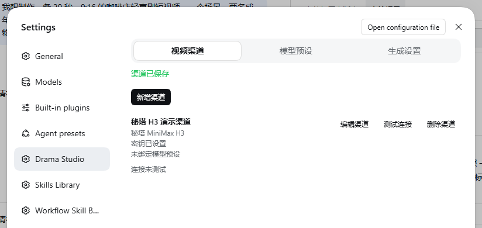
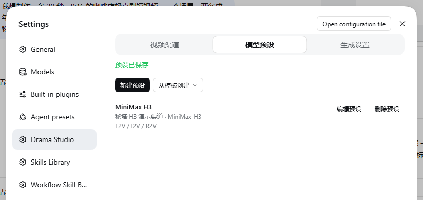

# 模型与视频渠道

[文档总览](../README.md) · [完成第一个项目](first-project.md) · [画布与镜头生成](canvas.md)

| 设置 | 在哪里 | 用来做什么 |
| --- | --- | --- |
| DSH 对话模型 | **Settings → Models**，然后在会话选择 | 和 AI 讨论、写剧本和保存阶段产物。 |
| Drama Studio 视频渠道 | **Settings → Drama Studio → 视频渠道** | 告诉工作台从哪里提交和查询视频任务。通常需要供应商密钥。 |
| 模型预设 | **Drama Studio → 模型预设** | 把一个模型和渠道绑定，声明能用的生成方式、参考素材和参数。 |
| 项目制作设置 | 会话输入栏 **制作设置 → 制作规格** | 指定整个工作区的成片画幅、目标时长。节点可另设单镜头时长及画幅。 |
| 当前会话自动生成许可 | 会话输入栏 **制作设置 → 生成执行设置** | 允许该会话在连接画布且符合部署和授权时自动入队。详见[自动执行生成](canvas.md#自动执行生成)。 |

渠道、预设和生成设置在同一 DSH Profile（运行配置）下跨项目共用，API 密钥交给 DSH 凭据服务保存。讨论和视频生成分别消耗各自服务的额度。对话模型配置也可参考 [DeepSeek Harness 用户指南](https://github.com/deepseek-ai/deepseek-harness/blob/master/docs/user/guide/index.md)。

## 配置示例：秘塔 MiniMax H3

下面的配置基于 **2026-11-12** 秘塔 MiniMax H3 的真实 T2V、I2V、R2V 验收。首次尝试可以从 4 秒单镜头开始。

1. 在左下角账户菜单打开 **Settings → Drama Studio → 视频渠道**。点 **新增渠道**，写一个容易识别的 **渠道名称**，在 **协议** 选择 **秘塔 MiniMax H3**，把服务方提供的密钥填入 **API 密钥**，点 **保存渠道**。此协议用内置地址。列表显示 **密钥已设置** 后继续。
2. 切到 **模型预设 → 从模板创建**，选 **秘塔 MiniMax H3 · MiniMax H3** 模板。检查绑定渠道和 **API Model ID** `MiniMax-H3`，核对方式和参数，点 **保存预设**。列表中应显示该模型与实际渠道。
3. 切到 **生成设置**，可选择该预设为 **默认视频模型**，点 **保存生成设置**。结果保存目录相对项目，默认 `assets/videos`，自定义目录须在 `assets/` 下。生成默认值与模型能力不符时，以模型支持范围和确认单校验为准。
4. 回 **视频渠道**，点对应渠道的 **测试连接**，选择该预设后点 **开始测试**。阅读面板结果。到画布建视频节点选该预设，先用 **T2V**，填写完整提示词，在确认单核对 **4 秒、768P、16:9**（历史实测组合）及渠道名称。若项目是 9:16，可按模型允许的组合在节点检查并设置画幅。在准备好额度后按[镜头生成步骤](canvas.md#提交镜头并查看结果)自行确认。

视频渠道页先保存渠道，再去模型预设绑定它。这里的演示凭据是用于拍摄的占位值。

**测试连接** 执行面板所示的配置、鉴权或目录检查。**目录可见** 表示模型在服务的目录中被找到。**真实任务成功** 来自实际提交、查询完成与成功下载；前两项通过后仍需独立验证生成。设置保存后，已连接画布会收到更新，已打开的确认单需要重新打开，已入队任务使用提交时保存的配置。

## 支持范围和验证证据

「界面与协议」表示当前 checkout 提供相应设置和输入路径，参数由预设和供应商限定。「自动化／模拟」和「真实服务」引用各轮历史记录。本轮候选包复验范围单独见[文档改版验收](../DOCS-REVAMP-VERIFICATION.md)。

| 渠道 | 界面与协议 | 自动化／模拟依据 | 已记录的真实服务 |
| --- | --- | --- | --- |
| 秘塔 MiniMax H3 | T2V、首帧及可选尾帧 I2V、混合素材 R2V。I2V 跟随首帧构图。 | 视频适配器和输入校验回归。 | 2026-11-12，秘塔 `MiniMax-H3`，T2V、单首帧 I2V、单参考图 R2V 完成并播放。 |
| OpenAI 兼容视频 | 视频创建、查询和下载。支持 T2V、首帧 I2V，需兼容网关实际提供接口。 | 兼容请求与固定接口的回归。 | 2026-11-12，秘塔兼容端点的 `MiniMax-H3` T2V。 |
| Custom REST | 自定义提交、查询、鉴权及字段映射，可按接口使用 T2V、I2V、R2V、V2V。 | 本地响应覆盖请求映射及相应输入类型。 | 2026-11-12，通过秘塔兼容端点映射的 `MiniMax-H3` T2V。真实 V2V 未在该次验收执行。 |
| New API Task / Video | 默认 Video 支持 T2V、首帧 I2V。高级配置设 Task 插件时，通用路径支持 T2V，`xai` 还可用 I2V、图片／音频 R2V。 | 两种路径有自动化覆盖。 | 该次验收没有跑真实 New API Task。 |
| 火山方舟、BytePlus ModelArk、Replicate | 使用内置适配器和模板，按模型声明选择方式；Replicate 也支持已配置的文生图。 | 详见原适配器和旧验收记录。 | 本页的五条真实任务不覆盖这些供应商。 |

[真实任务记录（2026-11-12）](../VIDEO-REFACTOR.md#秘塔-h3-真实验收) · [协议、输入与模拟回归](../VIDEO-REFACTOR.md#phase-24--协议输入与执行) · [早期验收记录](../VERIFICATION.md)

## 高级协议配置

- **New API Task / Video 和 OpenAI 兼容视频。** 按供应商提供的接口填 **Base URL**。New API 可带或省略末尾 `/v1`。Task 路径在 **高级协议配置 → Task 插件** 填插件键。OpenAI 兼容视频按网关格式用 `1280x720`，或 `720p` 搭配画幅。
- **Custom REST。** 在 **高级协议配置** 声明提交与查询地址、鉴权、任务 ID、状态、下载和请求字段映射。根据实际服务映射首尾帧、参考素材或源视频。本地媒体传输也要符合服务接口。可参照[字段和下载模板示例](../VIDEO-REFACTOR.md#后续配置参考)。
- **模型能力。** 用预设声明时长、分辨率、支持画幅、尾帧及参考素材限制。R2V 要检查各媒体类型的数量。Replicate 的视频 I2V/R2V 还需填写模型的图片输入字段。先在确认单验证最终参数，再提交。
