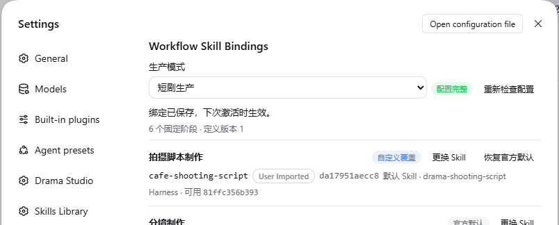
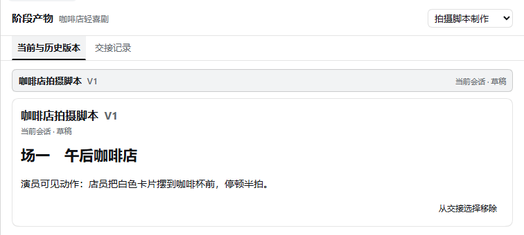

# 装填与优化自己的阶段 Skill

[项目首页](../../README.md#skills) · [文档总览](../README.md) · [完成第一个项目](first-project.md)

**Skill** 是一个阶段的制作方法。你可以沿用工作台配好的流程，把拍摄脚本换成自己的格式，或让成片验收遵循自己的审片清单。这篇用 **短剧生产 → 拍摄脚本制作** 演示怎样装填、比较和恢复。若想看出改动的效果，先用内置 Skill 试写一段，留好原阶段产物。

## 1. 把自己的 Skill 装进工作台

**已经有自己的 Skill。** 从 DSH Web 左下角打开 **Settings → Skills Library → 导入 Skill**，填写包含 `SKILL.md` 的本地文件夹路径，点 **导入文件夹**。文件夹名要与 `SKILL.md` 开头的 `name` 一致，`description` 要有内容。整个目录会复制到当前 DSH Home 的 Skills 库，模板和参考资料也一起带入。看到 **可绑定** 后，可以直接[绑定到制作阶段](#3-绑定到一个制作阶段并重新激活)。

**想从内置方法改起。** 在同一个库里搜索 `drama-shooting-script`，点 **查看详情 → 复制为自定义 Skill**，输入 `cafe-shooting-script`，点 **复制 Skill**。看到副本详情里的 **可绑定**，就可以按下一节的咖啡店示例改写规则。

[](../assets/screenshots/skill-copy.webp)

## 2. 把一个常见问题改成明确规则

在自定义副本的详情点 **打开 SKILL.md**。也可以 **复制路径**，在自己的编辑器打开。保留文件开头的名称、说明和可调用设置，在正文「输出与检查」下加一条规则。比如同一个咖啡店场景总写成「店员有些尴尬」，演员不知道怎么演，可以改成下面这条。

```markdown
- 每场补一行「演员可见动作」，只写演员能执行的动作。对白前后留出表演停顿。
```

保存文件，点 **刷新 Skill**。确认预览里出现新规则，再到下一步。每次先改一条，这次只检查「动作是否变得可演」，后续再试时长或输出模板。

[](../assets/screenshots/skill-edit.webp)

如果阶段还会读取 `references/` 或 `templates/`，把可复用例子留在副本的相对路径下，写清在哪一步读取。正文指令会在阶段激活时固定，附属资源按读取时的磁盘文件使用。

## 3. 绑定到一个制作阶段并重新激活

1. 打开 **Settings → Workflow Skill Bindings**。在 **生产模式** 选 **短剧生产**，找到 **拍摄脚本制作**。
2. 点 **更换 Skill**，搜索并选择 `cafe-shooting-script`，点 **保存绑定**。该行显示 **自定义覆盖**，并提示下次激活时生效。
3. 返回使用「短剧生产」的会话，待当前 Agent 回合结束。已处于该阶段时先点 **退出阶段**，再点击 **拍摄脚本制作**。如需做对照，也可用本项目的新会话激活该阶段。看到 **Skill · cafe-shooting-script** 就能开始试写。

[](../assets/screenshots/skill-bindings.webp)

绑定是当前 DSH Home 下、所选生产模式和阶段的全局设置。已经激活的会话继续使用原来的方法，直到重新激活。Stage Harness（阶段规则和允许做的操作）仍由工作台提供。 [工作流绑定与激活契约](../WORKFLOW.md#skills-library-与阶段绑定)

## 4. 用同一段输入检查效果

1. 打开调整前保存的官方产物，记下它的输出格式和需要改进的一点。
2. 绑定并激活自定义 Skill 后，使用同一段故事、同一个模型和同样的制作规格，例如「店员把白色卡片摆到咖啡杯旁，顾客误以为是在给自己拍照，保留原对白和结尾反转」。请 AI 保存拍摄脚本。
3. 在 **阶段产物** 看这三项。每场是否有可执行动作？对白及反转是否保留？产物能否按场拆分给下游？满足后再把自定义 Skill 用到其他项目。若结果有偏差，收紧最不清楚的一条指令，再刷新、退出并重新激活来比较。

[](../assets/screenshots/skill-output.webp)

图中是隔离演示里的阶段产物。对照自己的两版产物时，重点看新增规则有没有变成清楚可执行的动作。

回到 **Workflow Skill Bindings** 的相同模式和阶段，点 **恢复官方默认**，再重新激活阶段即可切回官方版本。你的自定义文件仍在 Skills Library 中。
